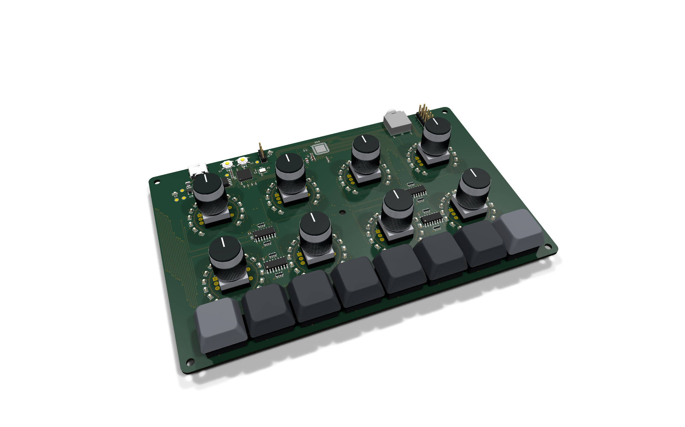
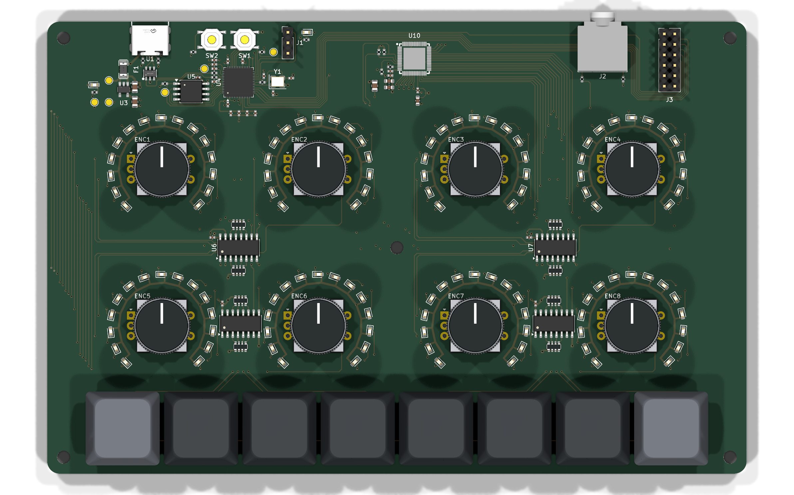
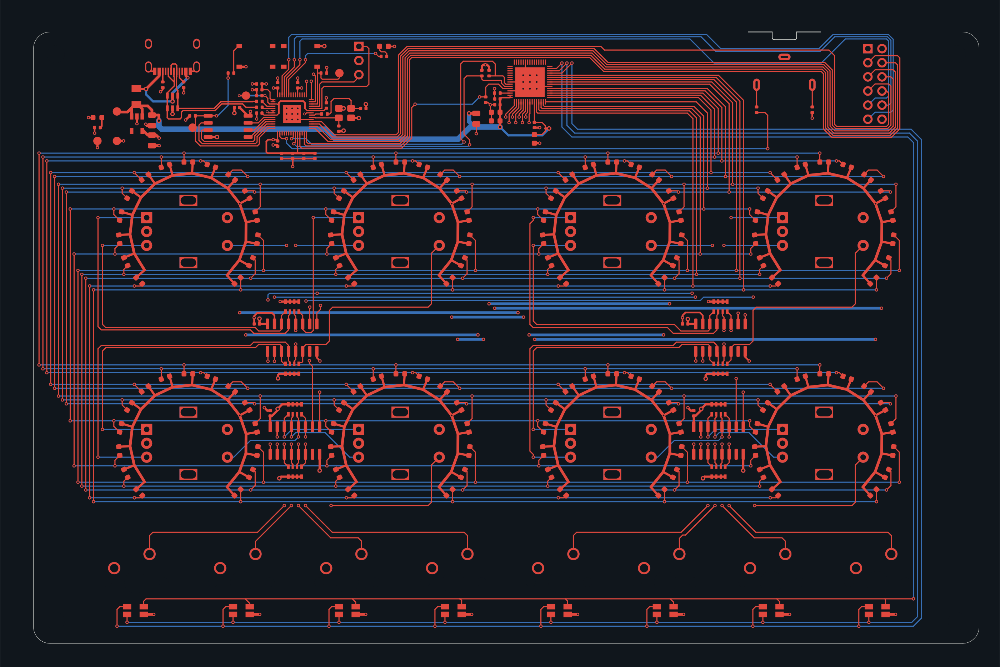
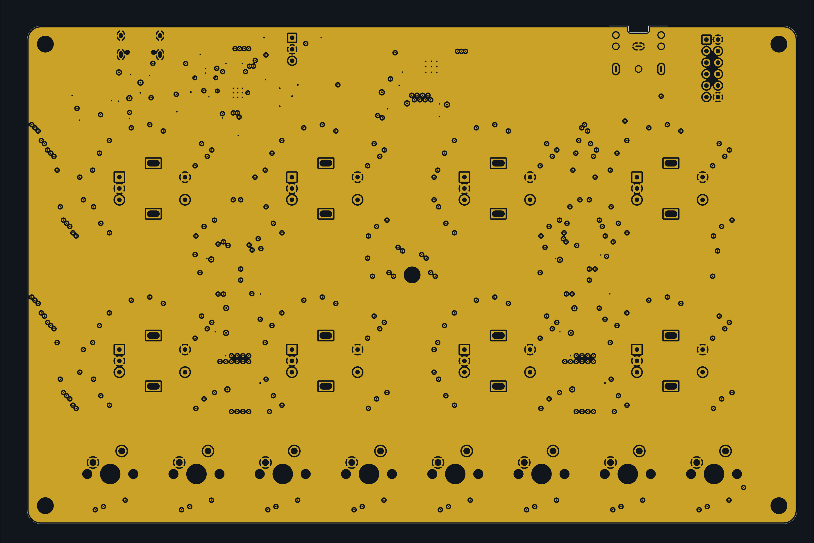
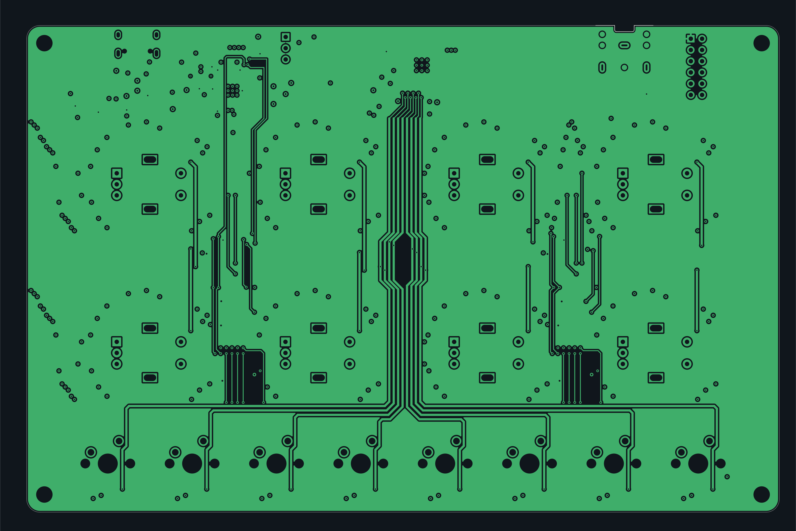

# midi-controller

Controlador USB-MIDI + HID basado en RP2040: 8 encoders con anillo de LEDs, 8 teclas mecánicas con LED RGB, salida MIDI TRS y header de expansión.

> **Estado: Rev. 1, diseño terminado y listo para fabricar.** Pasa ERC y DRC sin errores, tiene archivos de producción para JLCPCB y la revisión de pinouts contra las hojas de datos está hecha. Todavía no se fabricó: el arranque de la placa (bring-up) y el firmware son los próximos pasos.



---

## Características

- **RP2040 como chip suelto** (no un módulo Pico): flash QSPI W25Q16 de 2 MB, cristal de 12 MHz, USB-C con protección ESD y polyfuse.
- **32 entradas** leídas con 4× 74HC165 en cadena: 8 encoders EC11 (A, B y pulsador) y 8 teclas MX.
- **144 LEDs** manejados por un IS31FL3741A por I2C: 8 anillos de 15 LEDs y 8 LEDs RGB debajo de las teclas, con PWM independiente para cada LED.
- **MIDI TRS (Type A)** a 3.3 V, además de USB-MIDI.
- **Header de expansión** con 6 GPIO, 3 entradas ADC, 3V3 y GND, para variantes sin rediseñar la placa base.
- **Debug:** header SWD y botones BOOTSEL y RESET.

## Hardware

```
USB-C ──► ESD + polyfuse ──► LDO 3.3V ──┬──► RP2040 + flash QSPI + cristal 12 MHz
                                        │       ├─ SPI ──► 4× 74HC165 ◄── 8 encoders + 8 teclas
                                        │       ├─ I2C ──► IS31FL3741A ──► 8 anillos + 8 RGB
                                        │       ├─ UART ─► jack TRS (MIDI out)
                                        │       └─ GPIO / ADC ──► header de expansión
                                        └──► +5V ──► alimentación de la matriz de LEDs
```

| | |
|---|---|
| Herramienta | KiCad 9, esquemático jerárquico de 6 hojas |
| PCB | 4 capas (señal / GND / 3V3 / señal), ~170 × 110 mm, 1.6 mm |
| Reglas | Pista y separación de 0.2 mm (0.15 mm en el fan-out del RP2040 y del IS31) |
| Componentes | 204 piezas SMD y THT ensamblables en JLCPCB (Economic PCBA, una sola cara) |
| Costo del prototipo | ~USD 150 por 5 PCB, 2 de ellas ensambladas, sin envío ni impuestos |

### Decisiones de diseño

Cada decisión está explicada en detalle en [las notas de diseño](docs/notas-de-diseno.md). Las principales:

- **Registros de desplazamiento en lugar de GPIO directos.** 32 entradas con solo 3 pines. Cada chip se agrupa por zona de la placa y no por tipo de señal, para acortar el ruteo.
- **Matriz de LEDs a 5 V con lógica a 3.3 V.** Un LED blanco (~3 V) más la caída del driver (hasta 1.35 V) necesita unos 4.35 V, así que a 3.3 V no prendería. Alimentarla desde 5 V además evita que la corriente de los LEDs pase por el LDO. El IS31 acepta lógica de 3.3 V, así que no hace falta convertir niveles.
- **USB-C hecho bien.** Una resistencia de 5.1k en cada pin CC, para que funcione con cables C-a-C. ESD con un USBLC6 de tipo "flow-through" pegado al conector y resistencias de 27 Ω en D+/D− junto al RP2040.
- **BOOTSEL sin pin dedicado.** El botón tira QSPI_SS a GND a través de 1k: la ROM lo lee al arrancar y el RP2040 todavía puede manejar la línea.
- **Estados seguros al arrancar.** SDB del IS31 tiene un pull-down, así que los LEDs quedan apagados hasta que el firmware los habilita.
- **Ruteo.** Desacoples pegados a cada pin de alimentación, par USB ruteado junto y plano de GND continuo en In1.

## Imágenes

| Vista superior | Cobre: F.Cu (rojo) y B.Cu (azul) |
|---|---|
|  |  |

| Plano In1 (GND) | Plano In2 (3V3) |
|---|---|
|  |  |

Esquemático completo: [docs/esquematico-rev1.pdf](docs/esquematico-rev1.pdf)

## Verificación

- **ERC:** 0 errores. **DRC:** 0 violaciones, 0 pads sin conectar y placa en paridad con el esquemático.
- **Revisión manual de pinouts contra las hojas de datos:** USB-C, USBLC6, AP2112K, RP2040 (alimentación, cristal y QSPI), W25Q16, 74HC165 e IS31FL3741A.
- **Disponibilidad de componentes en JLCPCB/LCSC:** las piezas sin stock se reemplazaron por equivalentes o se marcaron para soldar a mano.

## Fabricación

Los archivos de producción para JLCPCB están en [`hardware/midi-controller/fab/jlcpcb/`](hardware/midi-controller/fab/jlcpcb/): Gerbers y taladros en un zip, BOM con códigos LCSC y CPL de posiciones.

Se sueldan a mano: el jack MIDI (J2), las teclas MX, y los headers SWD y de expansión.

## Próximos pasos

1. **Bring-up:** medir los rieles de alimentación (hay test points en +5V, +3V3 y +1V1), comprobar que el RP2040 enumera en modo BOOTSEL y hacer un escaneo I2C (el IS31 debe responder en 0x30).
2. **Firmware** (Pico SDK + TinyUSB): lectura de entradas en el core 1, USB-MIDI/HID y LEDs en el core 0. Las notas para el firmware están en la sección 8 de [las notas de diseño](docs/notas-de-diseno.md).
3. **Configurador web** con Web MIDI y SysEx.

La especificación completa está en [`controlador-midi-spec.md`](controlador-midi-spec.md).

## Estructura

| Carpeta | Contenido |
|---|---|
| `hardware/midi-controller/` | Proyecto KiCad 9 (esquemático jerárquico + PCB de 4 capas) |
| `hardware/midi-controller/fab/jlcpcb/` | Gerbers, BOM y CPL para JLCPCB |
| `docs/` | Notas de diseño, esquemático en PDF e imágenes |
| `firmware/` | Firmware (por empezar) |
| `configurator/` | Configurador web (por empezar) |
